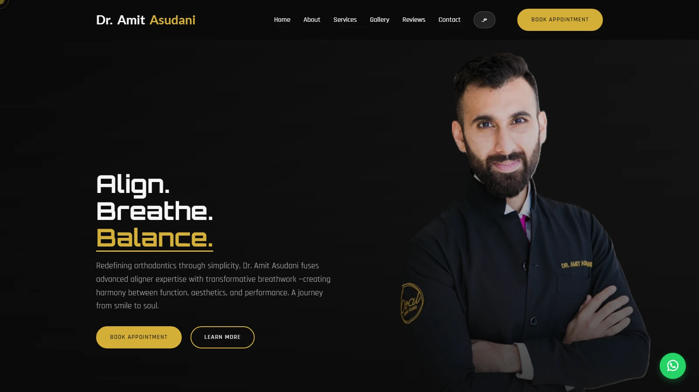

# Dr. Amit Asudani

Single-page website for Dr. Amit Asudani, a dentist and breath consultant in Dubai, with a full Arabic version. It introduces his aligner, bonding and breathwork services, shows a gallery and patient reviews, and lets visitors book an appointment, send a message or open a WhatsApp chat.



## What it does

- Serves an English page (`index.html`) and a right-to-left Arabic page (`index.ar.html`) with its own Arabic fonts, linked by a language switch in the header.
- Animates the hero and service cards on scroll with GSAP ScrollTrigger, and fades sections in with AOS.
- Shows a gallery slider built with Swiper that autoplays and can be swiped on touch screens.
- Lets visitors leave a star-rated review: it is saved in the browser's `localStorage`, shown in the reviews list straight away and sent by EmailJS.
- Sends the contact form by EmailJS, links the booking button to the contact section and embeds a Google Map of the clinic.
- Adapts the layout and hero image at breakpoints from 1148px down to 380px.

## Stack

HTML, CSS and JavaScript in two self-contained pages, with no build step. Libraries load from CDNs: GSAP and ScrollTrigger, AOS, Swiper, Font Awesome, Google Fonts and the EmailJS browser SDK.

## Run it locally

Open `index.html` in a browser, or serve the folder:

```bash
npx serve .
```

The forms need an EmailJS account. Replace `YOUR_EMAILJS_PUBLIC_KEY`, `YOUR_SERVICE_ID` and `YOUR_TEMPLATE_ID` in both pages with your own values.

## Credits

Built for Dr. Amit Asudani. The reviews and the clinic's phone, email and WhatsApp number in this repository are placeholders. Two gallery images are loaded from Unsplash under the Unsplash licence.

## Licence

The code is under the MIT licence. Dr. Amit Asudani's name, the clinic names and the photos belong to their owners and are not covered by the licence.
